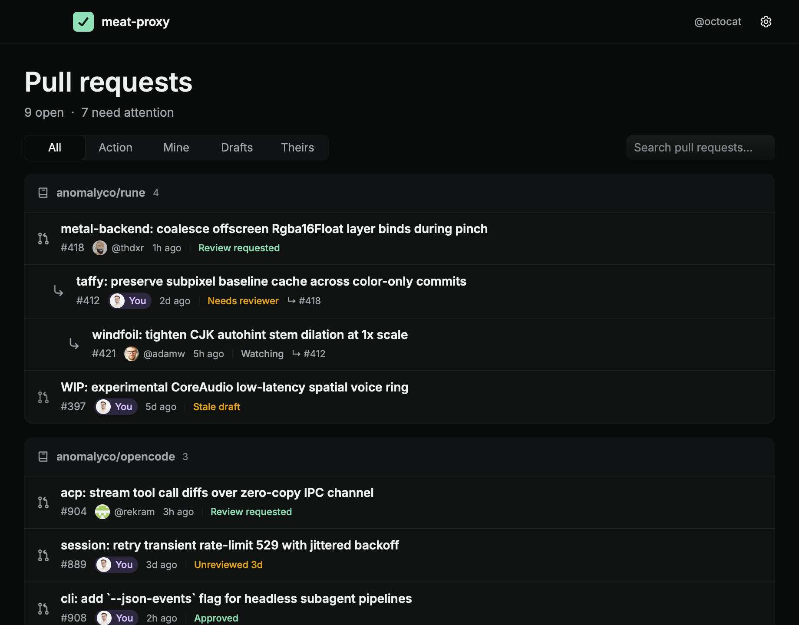

# meat-proxy

A native macOS inbox for GitHub pull requests, built with Rune. It groups PRs by repository, nests branch-based stacks, and reminds you about pending reviews and stale drafts.



## Run locally

Install Rust, Xcode Command Line Tools, and the GitHub CLI. From the repository root, run:

```sh
./package.sh
~/.cargo/bin/meat-proxy
```

The installer puts the app in `/Applications`. On first launch, connect your GitHub CLI account and choose your inbox filters and notification preferences.
