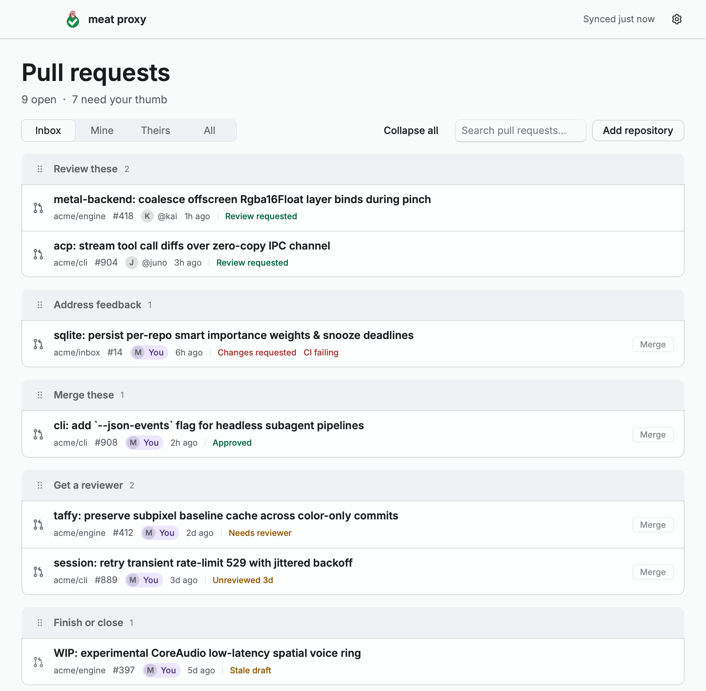

<p align="center"></p>

# meat proxy

Keep up with the pace of LLM-generated code.

A native macOS inbox for GitHub pull requests, built with Rune. It puts what needs your thumb first, grouped by the action each pull request needs, and merges your own once GitHub allows it. It reads GitHub through the GitHub CLI, as you are signed in to it.

<picture>
  <source media="(prefers-color-scheme: dark)" srcset="snapshots/inbox-dark.png">
  
</picture>

## Install

Install and sign in to the [GitHub CLI](https://cli.github.com) (`brew install gh && gh auth login`), then:

```sh
curl -fsSL https://github.com/peelar/meat-proxy/releases/latest/download/install-mac.sh | sh
```

It puts meat-proxy in `~/Applications` and keeps it at the latest release: a launchd agent checks every hour and
replaces the app while it is closed. `sh -s -- --uninstall` after the same command removes it. On first launch,
connect your GitHub CLI account and choose your inbox filters and notification preferences.

Every push to `main` publishes a release (`.github/workflows/release.yml`): the next patch, unless `Cargo.toml` names a
higher version.

## Build from source

Install Rust, Xcode Command Line Tools, and the GitHub CLI. From the repository root, run:

```sh
./package.sh
~/.cargo/bin/meat-proxy
```

This installs your build in `/Applications`, beside any released copy in `~/Applications`.
